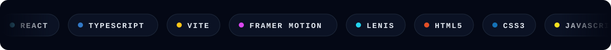
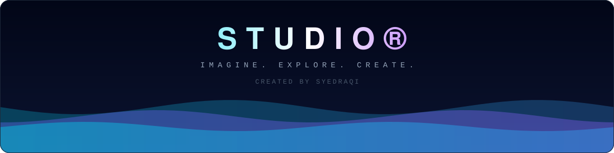

<div align="center">


<br/>

<a href="#concept"></a>
<a href="#experience"></a>
<a href="#technology"></a>
<a href="#launch"></a>
<a href="#anatomy"></a>

<br/><br/>


</div>



<a name="concept"></a>


<div align="center">

<br/>

### *The future isn't something we wait for.*
### *It's something we imagine, experiment with, and create.*

<br/>

**Studio** is a digital creative environment built to design, imagine, and prototype future products.<br/>
Not a portfolio. Not a template. An experimental space where ideas get room to become real.

<br/>

</div>


<a name="experience"></a>


<br/>



<br/>


<a name="technology"></a>


<br/>



<br/>

<div align="center">

| LAYER | TOOLING |
|:-----:|:-------:|
| **Framework** | React |
| **Language** | TypeScript |
| **Build tool** | Vite |
| **Animation** | Framer Motion |
| **Smooth scroll** | Lenis |
| **Automation** | GitHub Actions |

</div>

<br/>


<a name="launch"></a>


<br/>



<br/>

```bash
git clone https://github.com/SyedRaqi/Studio.git
cd Studio
npm install
npm run dev
```

> Open the local URL Vite prints in your terminal, usually `http://localhost:5173`.

<br/>


<a name="anatomy"></a>


<br/>

```text
Studio/
├── .github/workflows/   →  automation & deployment pipelines
├── public/              →  static assets
├── src/                 →  the experience: components, motion, styles
├── index.html           →  entry point
├── vite.config.ts       →  build configuration
├── tsconfig.json        →  TypeScript configuration
└── package.json         →  scripts & dependencies
```

<br/>


<a name="philosophy"></a>


<br/>


<br/>


<a name="production"></a>


<br/>

Contributions, ideas, and experiments are welcome.

```bash
git checkout -b feature/your-idea
git commit -m "Add: your idea"
git push origin feature/your-idea
```

Then open a Pull Request. Released under the [Unlicense](LICENSE): free to use, remix, and reimagine.

<br/>


